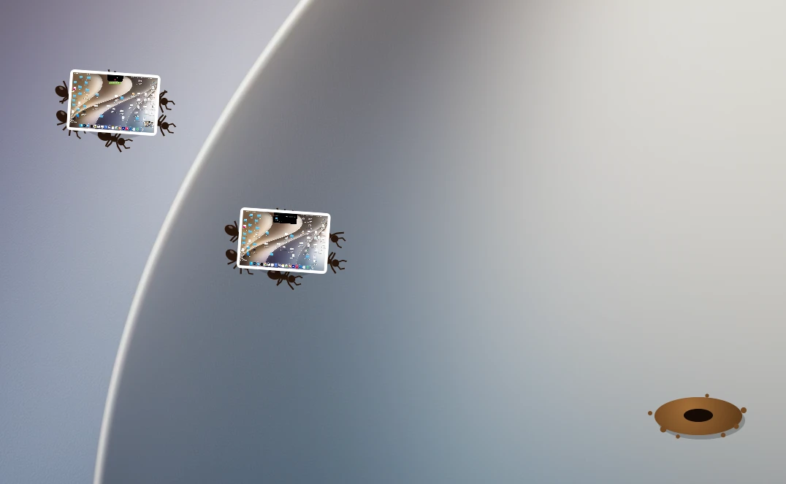
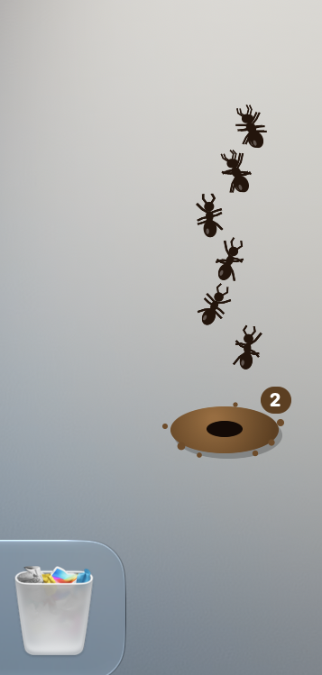

<div dir="rtl">

# لانه مورچه

[English](README.md) | **فارسی** | [Русский](README.ru.md)

مورچه‌هایی که دسکتاپت رو تمیز می‌کنن، یکی یکی و اسکرین‌شات به اسکرین‌شات.

</div>




<div dir="rtl">

یه لانه‌ی مورچه گوشه‌ی صفحه‌ات زندگی می‌کنه. اگه یه اسکرین‌شات زیادی روی دسکتاپ بمونه، شش تا مورچه میان بیرون، برش می‌دارن و می‌برنش توی لانه.

</div>

<p align="center">
  
</p>

<div dir="rtl">

## چطوری کار می‌کنه

- مورچه‌ها اسکرین‌شات‌ها و ضبط‌های صفحه‌ی روی دسکتاپ رو پیدا می‌کنن و به بقیه‌ی فایل‌ها کاری ندارن.
- هر گروه می‌ره سر جای واقعی فایل روی دسکتاپ و با هم بلندش می‌کنن.
- حداکثر دو گروه هم‌زمان بیرون هستن.
- عدد روی لانه نشون می‌ده چند تا اسکرین‌شات داخلشه.
- گاهی هم چند تا دیده‌بان میان بیرون و دور و بر رو نگاه می‌کنن.
- موس رو نزدیکشون ببری، فرار می‌کنن.

## اسکرین‌شات‌هات امن هستن

چیزی پاک نمی‌شه. اسکرین‌شات‌ها فقط به این پوشه منتقل می‌شن:

</div>

```
~/Pictures/Anthill/
```

<div dir="rtl">

مورچه‌ها به‌صورت پیش‌فرض ۲ دقیقه به اسکرین‌شات‌های جدید دست نمی‌زنن تا وقت داشته باشی ازشون استفاده کنی. یادت باشه بعدش بدون اینکه بپرسن برشون می‌دارن.

## منوی لانه

روی لانه کلیک کن تا منو باز بشه:

| گزینه | کارش |
| :--- | :--- |
| Send the ants now | زمان انتظار رو رد می‌کنه |
| Open the anthill | پوشه رو توی Finder باز می‌کنه |
| Bring them all back | همه رو برمی‌گردونه روی دسکتاپ و مورچه‌ها دیگه سراغ اون فایل‌ها نمی‌رن |
| Leave new screenshots alone for | زمان انتظار، از ۱ دقیقه تا ۱ روز |
| Let the ants nap | مورچه‌ها رو می‌خوابونه تا خودت بیدارشون کنی |
| Quit AntHill | برنامه رو می‌بنده |

## نصب

به macOS 14 یا بالاتر نیاز داره.

1. فایل zip رو از [آخرین نسخه](https://github.com/aarvviin/AntHill/releases/latest) دانلود کن.
2. از حالت فشرده درش بیار و `AntHill.app` رو ببر داخل Applications.
3. بازش کن. بار اول مک جلوش رو می‌گیره، چون برنامه توسط اپل notarize نشده.
4. برو به **System Settings > Privacy & Security**، پایین صفحه بیا و **Open Anyway** رو بزن.
5. وقتی مک پرسید AntHill می‌تونه Finder رو کنترل کنه، **OK** رو بزن. مورچه‌ها این‌طوری جای هر فایل رو پیدا می‌کنن. بدون این اجازه هم کار می‌کنن، ولی به یه نقطه‌ی تصادفی می‌رن.

یا به جای مرحله‌ی ۳ و ۴، این دستور رو یک بار در ترمینال بزن:

</div>

```bash
xattr -dr com.apple.quarantine /Applications/AntHill.app
```

<div dir="rtl">

لانه پایین سمت راست نمایشگر اصلیه. برنامه آیکون داک نداره، پس برای بستنش از منوی لانه استفاده کن.

## ساختن از روی کد

فقط Xcode Command Line Tools لازم داری.

</div>

```bash
git clone https://github.com/aarvviin/AntHill.git
```

```bash
cd AntHill
```

```bash
./scripts/build.sh
```

```bash
open build/AntHill.app
```

<div dir="rtl">

## ساختار پروژه

</div>

```
Sources/
  main.swift      desktop window, scanning and the menu
  Colony.swift    ant movement, crews and scouts
  AntView.swift   draws the ants, the hill and the screenshots
  Desk.swift      finds screenshots and moves them in and out
Resources/        Info.plist
scripts/          build and packaging
```

<div dir="rtl">

## حذف برنامه

**Bring them all back** رو بزن، برنامه رو ببند و `AntHill.app` رو پاک کن. برای پاک کردن تنظیماتش هم این دستور رو بزن:

</div>

```bash
defaults delete io.github.aarvviin.anthill
```

<div dir="rtl">

## سازنده

ساخته‌ی **آروین**. برای ارتباط توی تلگرام پیام بده: [@aarrrvin](https://t.me/aarrrvin)

## لایسنس

[MIT](LICENSE). هر طور دوست داری استفاده کن، فقط اسم من بمونه.

</div>
