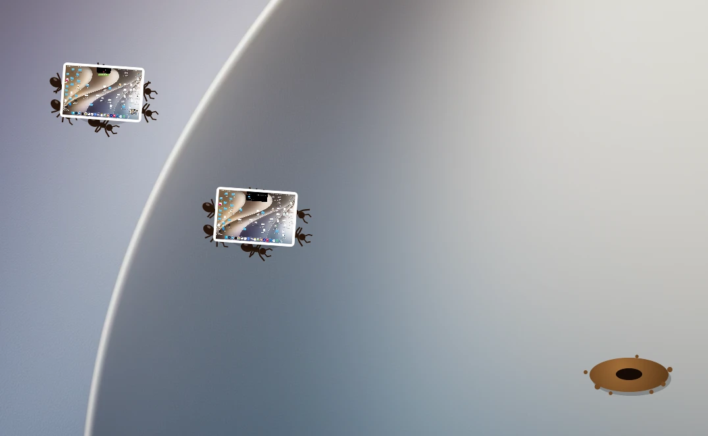
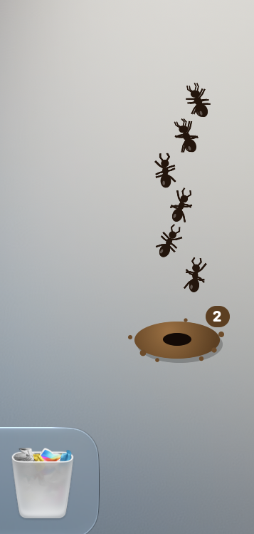

# AntHill

**English** | [فارسی](README.fa.md) | [Русский](README.ru.md)

Ants that clean up your Desktop, one screenshot at a time.




An anthill lives in the corner of your screen. When a screenshot sits on your Desktop for too long, six ants walk out, pick it up and carry it back to the nest.

<p align="center">
  
</p>

## How it works

- Ants find screenshots and screen recordings sitting on your Desktop. Other files are left alone.
- Each crew walks to the file's real position on the Desktop and lifts it together.
- Up to two crews can be out at the same time.
- The number on the hill shows how many screenshots are inside.
- Scouts wander out now and then to have a look around.
- Bring your cursor close and the ants run away from it.

## Your screenshots are safe

Nothing gets deleted. Screenshots are moved to:

```
~/Pictures/Anthill/
```

New screenshots are left alone for 2 minutes by default, so you have time to use them. Keep in mind that after that, the ants take them without asking.

## The anthill menu

Click the anthill to open the menu:

| Item | What it does |
| :--- | :--- |
| Send the ants now | Skips the waiting time |
| Open the anthill | Opens the folder in Finder |
| Bring them all back | Moves everything back to the Desktop, and the ants won't take those files again |
| Leave new screenshots alone for | Waiting time, from 1 minute to 1 day |
| Let the ants nap | Pauses the ants until you wake them |
| Quit AntHill | Closes the app |

## Install

Requires macOS 14 or later.

1. Download the zip from the [latest release](https://github.com/aarvviin/AntHill/releases/latest).
2. Unzip it and move `AntHill.app` to Applications.
3. Open it. macOS will block it the first time because the app isn't notarized by Apple.
4. Go to **System Settings > Privacy & Security**, scroll down and click **Open Anyway**.
5. When macOS asks if AntHill can control Finder, click **OK**. That's how the ants find where each file is. Without it they still work, but they walk to a random spot.

Or run this once instead of steps 3 and 4:

```bash
xattr -dr com.apple.quarantine /Applications/AntHill.app
```

The anthill sits in the bottom right corner of your main display. The app has no Dock icon, so use the anthill menu to quit.

## Build from source

You only need the Xcode Command Line Tools.

```bash
git clone https://github.com/aarvviin/AntHill.git
```

```bash
cd AntHill
```

```bash
./scripts/build.sh
```

```bash
open build/AntHill.app
```

## Project layout

```
Sources/
  main.swift      desktop window, scanning and the menu
  Colony.swift    ant movement, crews and scouts
  AntView.swift   draws the ants, the hill and the screenshots
  Desk.swift      finds screenshots and moves them in and out
Resources/        Info.plist
scripts/          build and packaging
```

## Uninstall

Choose **Bring them all back**, quit the app, then delete `AntHill.app`. To clear its settings too:

```bash
defaults delete io.github.aarvviin.anthill
```

## Author

Made by **Arvin**. Message me on Telegram: [@aarrrvin](https://t.me/aarrrvin)

## License

[MIT](LICENSE). Use it however you like, just keep my name in it.
