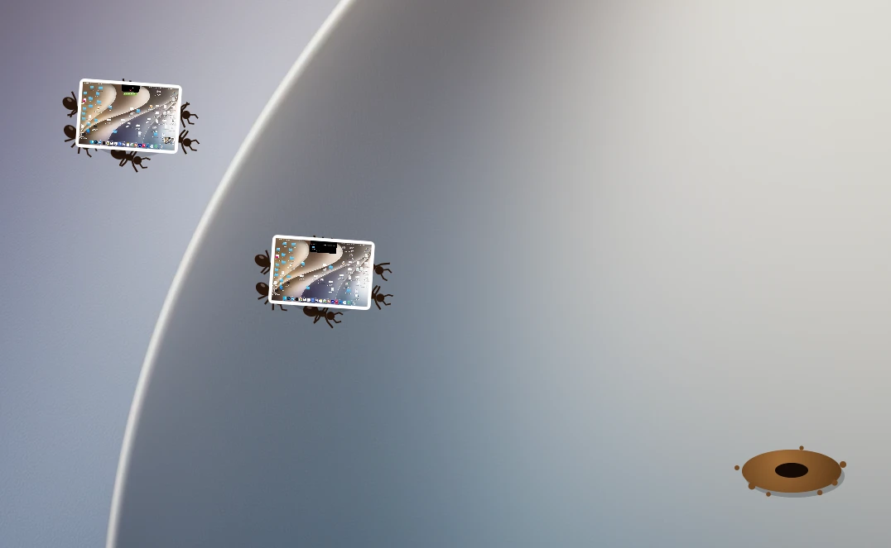
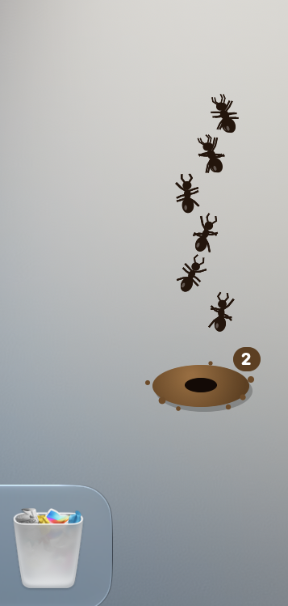

# Муравейник

[English](README.md) | [فارسی](README.fa.md) | **Русский**

Муравьи, которые убирают рабочий стол, скриншот за скриншотом.




В углу экрана живёт муравейник. Если скриншот слишком долго лежит на рабочем столе, шесть муравьёв выходят наружу, поднимают его и уносят в гнездо.

<p align="center">
  
</p>

## Как это работает

- Муравьи находят скриншоты и записи экрана на рабочем столе. Другие файлы они не трогают.
- Каждая группа идёт к настоящему положению файла на рабочем столе, и муравьи поднимают его вместе.
- Одновременно снаружи могут быть две группы.
- Число на муравейнике показывает, сколько скриншотов внутри.
- Иногда разведчики выходят осмотреться.
- Поднесите курсор поближе, и муравьи разбегутся.

## Ваши скриншоты в безопасности

Ничего не удаляется. Скриншоты просто перемещаются сюда:

```
~/Pictures/Anthill/
```

По умолчанию новые скриншоты не трогаются 2 минуты, чтобы вы успели ими воспользоваться. Но после этого муравьи заберут их без спроса.

## Меню муравейника

Нажмите на муравейник, чтобы открыть меню:

| Пункт | Что делает |
| :--- | :--- |
| Send the ants now | Пропускает время ожидания |
| Open the anthill | Открывает папку в Finder |
| Bring them all back | Возвращает всё на рабочий стол, и муравьи больше не тронут эти файлы |
| Leave new screenshots alone for | Время ожидания, от 1 минуты до 1 дня |
| Let the ants nap | Усыпляет муравьёв, пока вы их не разбудите |
| Quit AntHill | Закрывает приложение |

## Установка

Нужна macOS 14 или новее.

1. Скачайте zip-архив из [последнего релиза](https://github.com/aarvviin/AntHill/releases/latest).
2. Распакуйте его и перенесите `AntHill.app` в Applications.
3. Откройте приложение. В первый раз macOS его заблокирует, потому что оно не нотариализовано Apple.
4. Откройте **System Settings > Privacy & Security**, прокрутите вниз и нажмите **Open Anyway**.
5. Когда macOS спросит, может ли AntHill управлять Finder, нажмите **OK**. Так муравьи узнают, где лежит каждый файл. Без этого они тоже работают, но идут в случайное место.

Или вместо шагов 3 и 4 один раз выполните в Терминале:

```bash
xattr -dr com.apple.quarantine /Applications/AntHill.app
```

Муравейник находится в правом нижнем углу основного дисплея. У приложения нет значка в Dock, поэтому для выхода используйте меню муравейника.

## Сборка из исходников

Нужны только Xcode Command Line Tools.

```bash
git clone https://github.com/aarvviin/AntHill.git
```

```bash
cd AntHill
```

```bash
./scripts/build.sh
```

```bash
open build/AntHill.app
```

## Структура проекта

```
Sources/
  main.swift      desktop window, scanning and the menu
  Colony.swift    ant movement, crews and scouts
  AntView.swift   draws the ants, the hill and the screenshots
  Desk.swift      finds screenshots and moves them in and out
Resources/        Info.plist
scripts/          build and packaging
```

## Удаление

Выберите **Bring them all back**, закройте приложение и удалите `AntHill.app`. Чтобы очистить и настройки, выполните:

```bash
defaults delete io.github.aarvviin.anthill
```

## Автор

Сделал **Арвин**. Пишите в Telegram: [@aarrrvin](https://t.me/aarrrvin)

## Лицензия

[MIT](LICENSE). Используйте как угодно, только сохраните моё имя.
